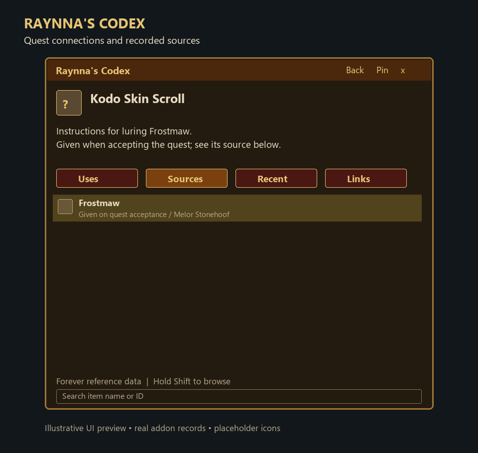
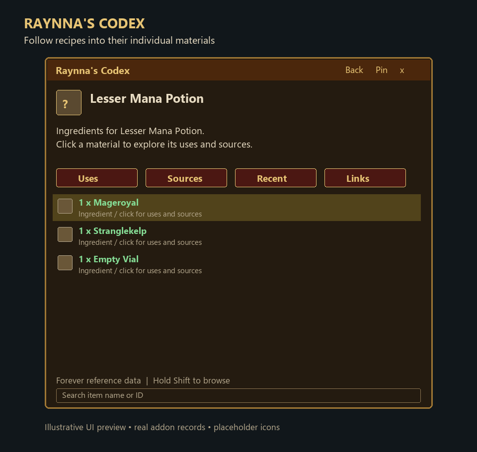
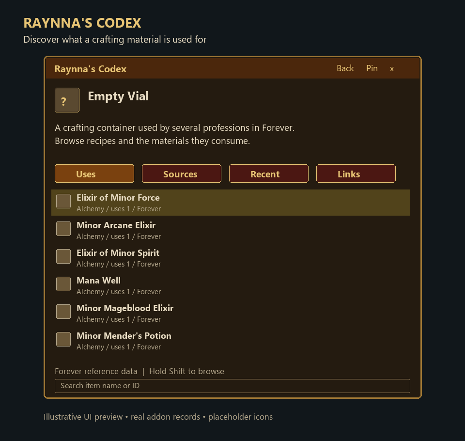

# Raynna’s Codex

Find out **what items are used for, how they are made, and where to find them** with a compact reference browser for **WoW Forever**.

## Explore items

**Hold Shift while hovering over an item** to view its description, recorded uses and sources.

Browse crafting recipes, related quests, vendors, monster drops, containers and world objects where information is available.

## Follow crafting ingredients

Click **Made with** to explore a recipe’s materials:

- A single ingredient opens its item entry directly.
- Multiple ingredients open a clickable list with quantities.
- Use **Back** to return to the previous item or list.

Crafting information uses a **Forever-specific client-data snapshot**. Source labels distinguish other reference data, including Classic loot fallbacks.

## Find item sources

Browse NPC portraits, known drop chances and source locations. **Click a source with recorded coordinates** to place a waypoint and open its map.

Quest-supplied items show their associated quest and quest giver where known.

## Built for convenient browsing

- Compact brown-and-gold interface with item icons and quality colours.
- Scrollable lists, item search and recently viewed items.
- Shift-hover selection stays locked while you move into the panel.
- Adjustable scale, including **Ctrl + mouse wheel**.
- Only the **Pin** button pins the panel.
- Preferences and recent items saved per character.

Works standalone. Reference data is bundled offline; coverage varies and updates arrive through addon releases.

Open **Escape → Settings → AddOns → Raynna’s mods → Codex** to customise the addon.

## Commands

- `/rc` — Open Codex.
- `/rc 3371` — Look up an item by ID.
- `/rc Empty Vial` — Search by name.
- `/rc hide` — Hide the panel.
- `/rc settings` — Open settings.

## Download

[Download the player ZIP](dist/RaynnaCodex-0.3.0-CurseForge.zip) and extract the RaynnaCodex folder into Interface/AddOns.

## Example previews

These are illustrative documentation renders using actual addon records and placeholder icons, not in-game screenshots.

See [coverage and data credits](RaynnaCodex/README.md) and [release instructions](RELEASING.md).
